# Bioinformatics Analysis Report: Protein Structural and Compositional Trends

## Theoretical Introduction

The analysis of protein data provides crucial insights into both the evolution of biological mechanisms and the advancement of structural biology techniques. This report investigates two main areas: the historical progression of structure determination methods and the statistical composition of proteins across different organisms.

Historically, X-ray crystallography has dominated the Protein Data Bank (PDB). However, X-ray crystallography requires a challenging, time-consuming, and highly expensive protein crystallization process. In contrast, recent technological leaps in detector technology and computational processing have caused a "Resolution Revolution" in Cryo-Electron Microscopy (Cryo-EM)[cite: 1]. Cryo-EM allows for the study of large macromolecular complexes in their native, aqueous state without the need for crystals, fundamentally shifting how structures are solved and drastically reducing historical bottlenecks.

Biologically, the primary structure of a protein dictates more than just its fold; it governs its cellular lifespan. According to the **N-end rule**, the *in vivo* half-life of a protein is heavily influenced by its N-terminal amino acid residue[cite: 2]. Destabilizing N-terminal residues trigger rapid ubiquitin-dependent (in eukaryotes) or distinct proteolytic degradation (in bacteria). Consequently, statistical analysis of N-termini and overall amino acid content across diverse species (E coli, Human, Yeast, A thaliana, D melanogaster, C elegans, Mouse, Zebrafish, B subtilis) and broad taxonomic kingdoms (Bacteria, Viruses, Archaea, Eukaryota) can reveal evolutionary pressures and distinct metabolic strategies employed by different organisms.

***
## Methodology

### Structural Database Trends Analysis (PDB)
Metadata was acquired directly from the PDB (`entries.idx` and `pdb_seqres.txt`). By filtering specifically for protein entries and weighting the data using the formula $\sum(n \cdot 1/r)$ (where $n$ is the sequence length, and $r$ is resolution). This solution took into consideration not only length but also quality of data.

### Protein Length and Composition Analysis
Sequences for targeted species (E coli, Human, Yeast, A thaliana, D melanogaster, C elegans, Mouse, Zebrafish, B subtilis) and randomly sampled sequences from kingdoms (100 sequences each) were retrieved from the UniProtKB REST API. Random sampling of kingdoms partially prevents database bias from skewing the macroscopic view. To estimate the standard error of mean protein lengths and amino acid frequencies, statistical bootstrapping (95% confidence interval) was employed.

***

## Results and Analysis

### Structural Database Trends Analysis (PDB)

::: {.content-visible when-format="html"}
#### Animated Trends (GIFs)

The following charts illustrate the historical dominance and recent shifts in techniques used to determine protein structures deposited in the PDB.

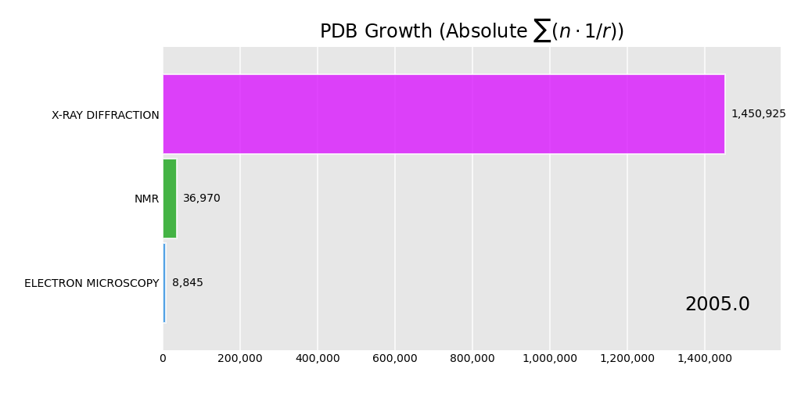
*Figure 0.1: Animated progression of accumulated structures by method over time.*

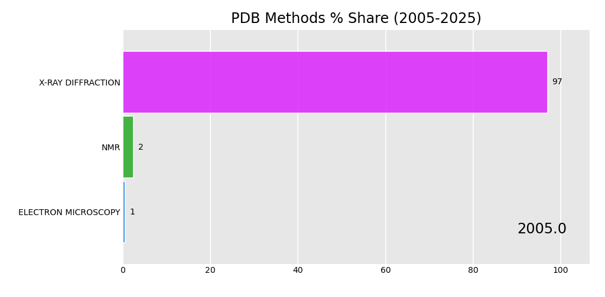
*Figure 0.2: Animated progression of structures percentage by method over time.*
:::

#### Structural Analysis, Interactive Data

::: {.content-visible when-format="html"}
Below is the interactive structural growth timeline (2005-2025). You can use the slider to change the year.

<object data="results/plots/pdb_trends_interactive.html" width="100%" height="500px">
    <embed src="results/plots/pdb_trends_interactive.html" width="100%" height="500px"> </embed>
    Error: Embedded content could not be displayed.
</object>
:::

::: {.content-visible when-format="pdf"}
*Note: The interactive structural growth timeline (2005-2025) is available in the HTML version of this report.*
:::

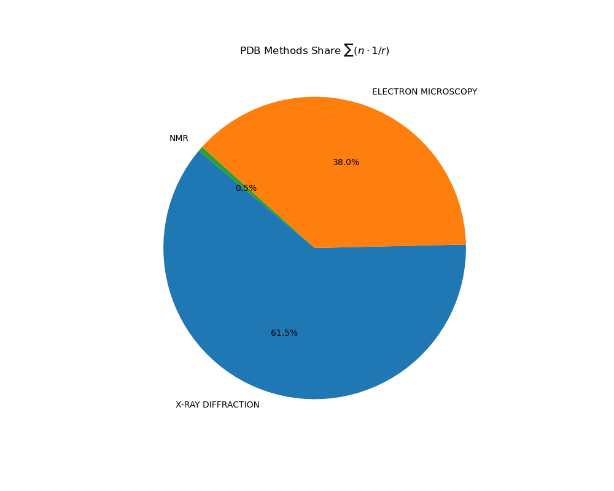
*Figure 1: Overall distribution of structural determination methods in the PDB.*

We can observe that in recent years *electron microscopy* became more popular. That is because it provides general method for investigating proteins with high resolution. It also does not incorporate protein crystallization which is hardest part in X ray crystallography. 

### Protein Length and Composition Analysis

Based on the parsed UniProt FASTA files, we analyzed the frequency of specific amino acids at the N-terminus, as well as the overall sequence length distributions.

#### Length comparison between groups

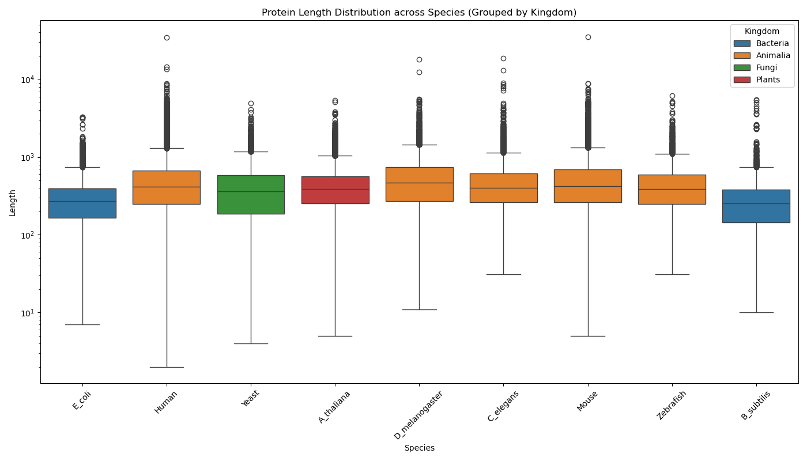
*Figure 2: Distribution of protein lengths across selected species grouped by taxonomy.*

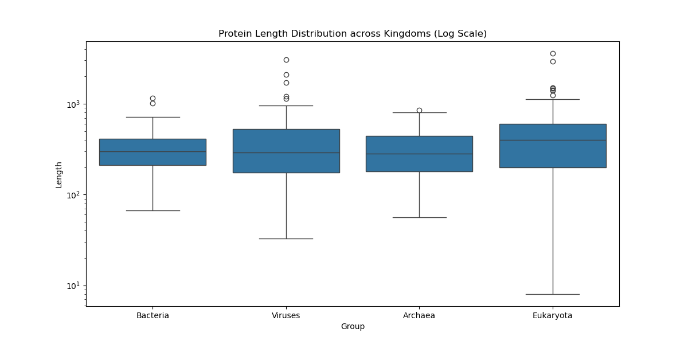
*Figure 3: Distribution of protein lengths across kingdoms.*

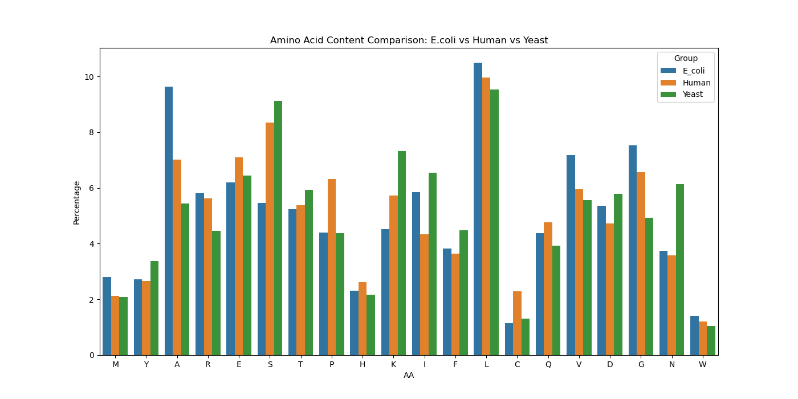
*Figure 4: Percentage content of amino acids across E.coli, Human, and Yeast.*

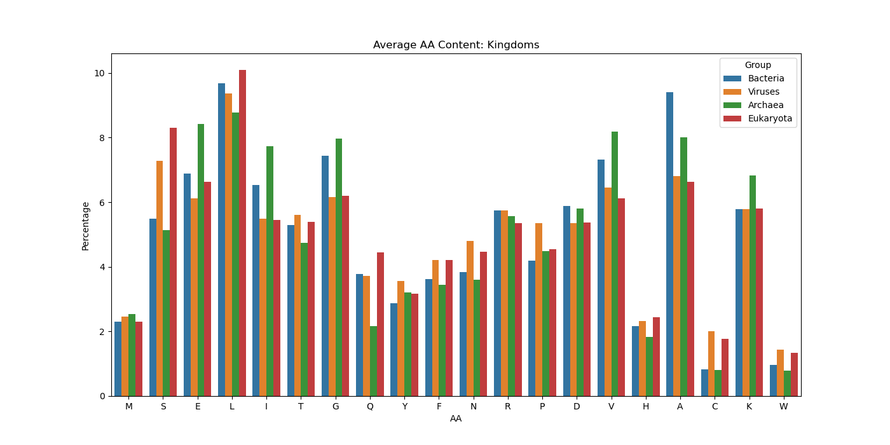
*Figure 5: Average amino acid content across taxonomic kingdoms.*

***

#### Protein Length Histograms
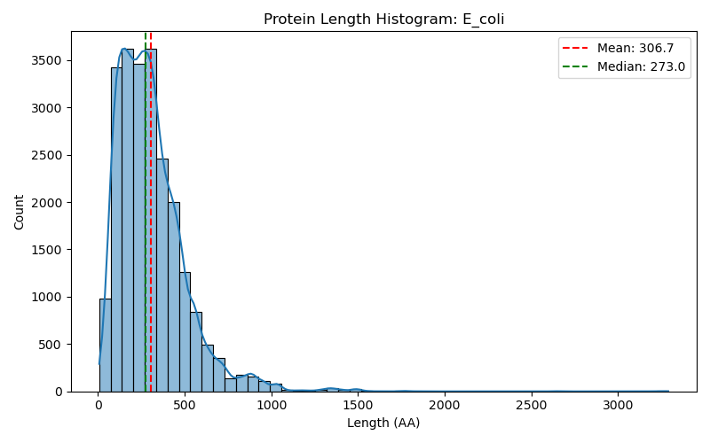
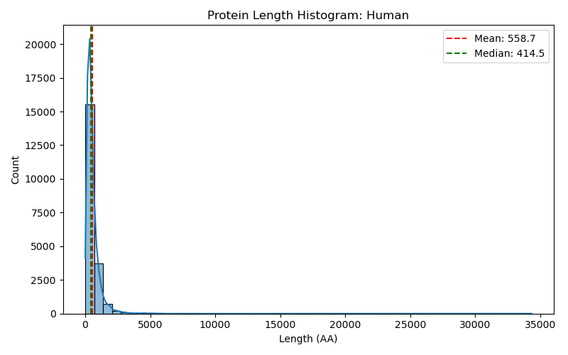
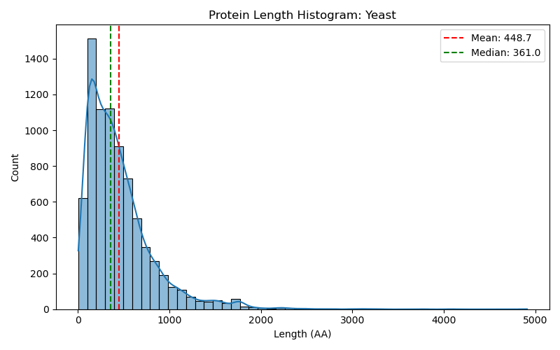
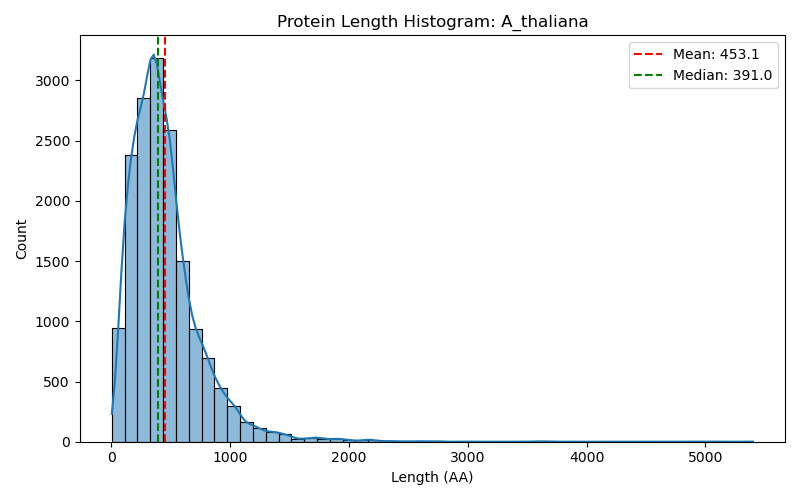
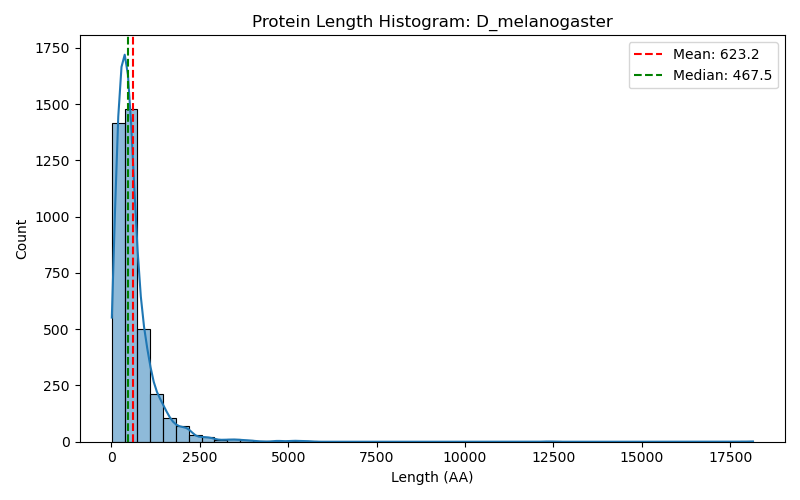
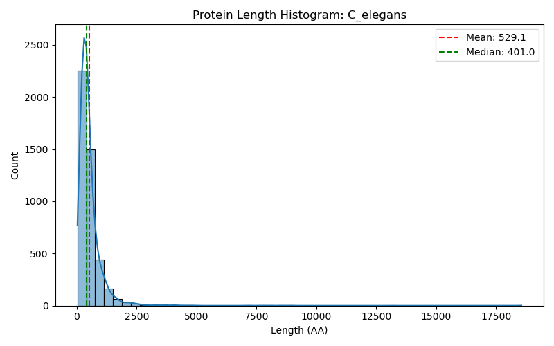
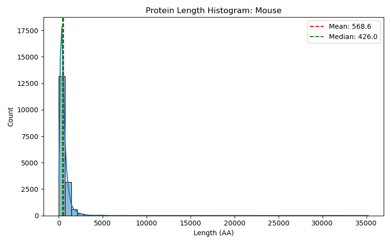
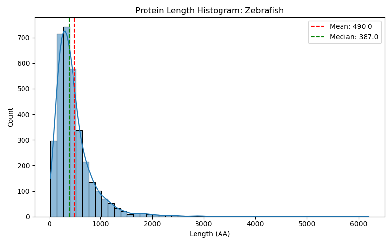
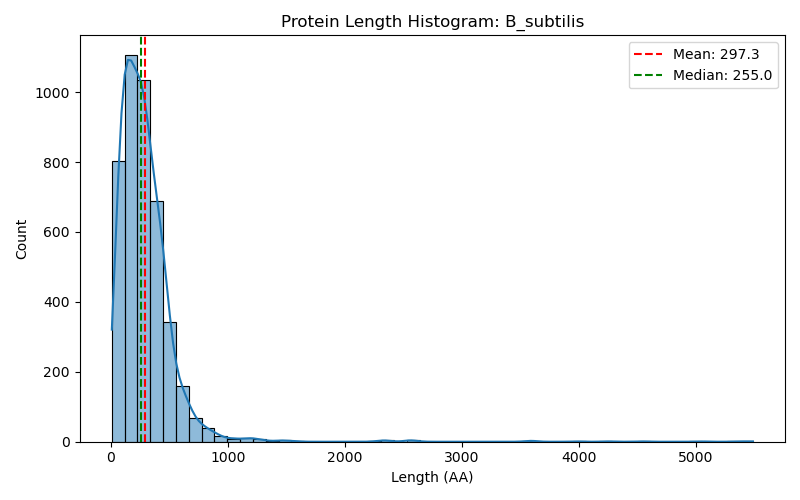

#### Statistical Tables
##### Species - Length Statistics

| Group          |   Mean_Length |    SE |   Median_Length |   Sample_Size |
|:---------------|--------------:|------:|----------------:|--------------:|
| E_coli         |        306.71 |  2.74 |             273 |         23290 |
| Human          |        558.67 |  7.53 |             414 |         20434 |
| Yeast          |        448.67 |  5.18 |             361 |          7933 |
| A_thaliana     |        453.07 |  4.23 |             391 |         16418 |
| D_melanogaster |        623.24 | 10.56 |             467 |          3874 |
| C_elegans      |        529.14 |  8.71 |             401 |          4499 |
| Mouse          |        568.64 |  7.84 |             426 |         17274 |
| Zebrafish      |        489.95 |  6.95 |             387 |          3369 |
| B_subtilis     |        297.32 |  4.3  |             255 |          4312 |

##### Species - Amino Acid Content (with StdErr)

| Group          | AminoAcid   |   Percentage |   StdErr |
|:---------------|:------------|-------------:|---------:|
| E_coli         | A           |         9.64 |    0.193 |
| E_coli         | C           |         1.14 |    0.069 |
| E_coli         | D           |         5.37 |    0.148 |
| E_coli         | E           |         6.19 |    0.158 |
| E_coli         | F           |         3.83 |    0.126 |
| E_coli         | G           |         7.52 |    0.173 |
| E_coli         | H           |         2.31 |    0.098 |
| E_coli         | I           |         5.85 |    0.154 |
| E_coli         | K           |         4.52 |    0.136 |
| E_coli         | L           |        10.5  |    0.201 |
| E_coli         | M           |         2.8  |    0.108 |
| E_coli         | N           |         3.75 |    0.124 |
| E_coli         | P           |         4.41 |    0.134 |
| E_coli         | Q           |         4.37 |    0.134 |
| E_coli         | R           |         5.8  |    0.153 |
| E_coli         | S           |         5.47 |    0.149 |
| E_coli         | T           |         5.24 |    0.146 |
| E_coli         | V           |         7.18 |    0.169 |
| E_coli         | W           |         1.41 |    0.077 |
| E_coli         | Y           |         2.71 |    0.106 |
| Human          | A           |         7.01 |    0.179 |
| Human          | C           |         2.3  |    0.105 |
| Human          | D           |         4.73 |    0.149 |
| Human          | E           |         7.11 |    0.18  |
| Human          | F           |         3.65 |    0.131 |
| Human          | G           |         6.56 |    0.173 |
| Human          | H           |         2.62 |    0.112 |
| Human          | I           |         4.34 |    0.143 |
| Human          | K           |         5.73 |    0.163 |
| Human          | L           |         9.96 |    0.209 |
| Human          | M           |         2.13 |    0.101 |
| Human          | N           |         3.58 |    0.13  |
| Human          | P           |         6.32 |    0.17  |
| Human          | Q           |         4.77 |    0.149 |
| Human          | R           |         5.63 |    0.161 |
| Human          | S           |         8.35 |    0.194 |
| Human          | T           |         5.38 |    0.158 |
| Human          | V           |         5.96 |    0.166 |
| Human          | W           |         1.21 |    0.077 |
| Human          | Y           |         2.66 |    0.113 |
| Yeast          | A           |         5.45 |    0.255 |
| Yeast          | C           |         1.31 |    0.127 |
| Yeast          | D           |         5.78 |    0.262 |
| Yeast          | E           |         6.45 |    0.276 |
| Yeast          | F           |         4.48 |    0.232 |
| Yeast          | G           |         4.94 |    0.243 |
| Yeast          | H           |         2.18 |    0.164 |
| Yeast          | I           |         6.54 |    0.278 |
| Yeast          | K           |         7.33 |    0.293 |
| Yeast          | L           |         9.53 |    0.33  |
| Yeast          | M           |         2.09 |    0.161 |
| Yeast          | N           |         6.14 |    0.27  |
| Yeast          | P           |         4.38 |    0.23  |
| Yeast          | Q           |         3.92 |    0.218 |
| Yeast          | R           |         4.47 |    0.232 |
| Yeast          | S           |         9.12 |    0.323 |
| Yeast          | T           |         5.93 |    0.265 |
| Yeast          | V           |         5.56 |    0.257 |
| Yeast          | W           |         1.04 |    0.114 |
| Yeast          | Y           |         3.37 |    0.203 |
| A_thaliana     | A           |         6.48 |    0.192 |
| A_thaliana     | C           |         1.8  |    0.104 |
| A_thaliana     | D           |         5.34 |    0.175 |
| A_thaliana     | E           |         6.6  |    0.194 |
| A_thaliana     | F           |         4.34 |    0.159 |
| A_thaliana     | G           |         6.55 |    0.193 |
| A_thaliana     | H           |         2.22 |    0.115 |
| A_thaliana     | I           |         5.42 |    0.177 |
| A_thaliana     | K           |         6.26 |    0.189 |
| A_thaliana     | L           |         9.64 |    0.23  |
| A_thaliana     | M           |         2.5  |    0.122 |
| A_thaliana     | N           |         4.41 |    0.16  |
| A_thaliana     | P           |         4.74 |    0.166 |
| A_thaliana     | Q           |         3.47 |    0.143 |
| A_thaliana     | R           |         5.3  |    0.175 |
| A_thaliana     | S           |         8.88 |    0.222 |
| A_thaliana     | T           |         5.13 |    0.172 |
| A_thaliana     | V           |         6.77 |    0.196 |
| A_thaliana     | W           |         1.25 |    0.087 |
| A_thaliana     | Y           |         2.9  |    0.131 |
| D_melanogaster | A           |         7.42 |    0.421 |
| D_melanogaster | C           |         1.8  |    0.214 |
| D_melanogaster | D           |         5.27 |    0.359 |
| D_melanogaster | E           |         6.49 |    0.396 |
| D_melanogaster | F           |         3.58 |    0.298 |
| D_melanogaster | G           |         6.09 |    0.384 |
| D_melanogaster | H           |         2.66 |    0.258 |
| D_melanogaster | I           |         4.98 |    0.349 |
| D_melanogaster | K           |         5.69 |    0.372 |
| D_melanogaster | L           |         9.27 |    0.466 |
| D_melanogaster | M           |         2.39 |    0.245 |
| D_melanogaster | N           |         4.71 |    0.34  |
| D_melanogaster | P           |         5.28 |    0.359 |
| D_melanogaster | Q           |         5.3  |    0.36  |
| D_melanogaster | R           |         5.46 |    0.365 |
| D_melanogaster | S           |         8.2  |    0.441 |
| D_melanogaster | T           |         5.57 |    0.368 |
| D_melanogaster | V           |         5.91 |    0.379 |
| D_melanogaster | W           |         0.99 |    0.159 |
| D_melanogaster | Y           |         2.94 |    0.272 |
| C_elegans      | A           |         6.66 |    0.372 |
| C_elegans      | C           |         1.88 |    0.203 |
| C_elegans      | D           |         5.69 |    0.345 |
| C_elegans      | E           |         6.92 |    0.378 |
| C_elegans      | F           |         4.24 |    0.3   |
| C_elegans      | G           |         5.55 |    0.341 |
| C_elegans      | H           |         2.36 |    0.226 |
| C_elegans      | I           |         5.76 |    0.347 |
| C_elegans      | K           |         6.37 |    0.364 |
| C_elegans      | L           |         8.43 |    0.414 |
| C_elegans      | M           |         2.66 |    0.24  |
| C_elegans      | N           |         4.76 |    0.318 |
| C_elegans      | P           |         4.97 |    0.324 |
| C_elegans      | Q           |         4.28 |    0.302 |
| C_elegans      | R           |         5.42 |    0.338 |
| C_elegans      | S           |         7.99 |    0.404 |
| C_elegans      | T           |         5.72 |    0.346 |
| C_elegans      | V           |         6.26 |    0.361 |
| C_elegans      | W           |         1.08 |    0.154 |
| C_elegans      | Y           |         3.02 |    0.255 |
| Mouse          | A           |         6.99 |    0.194 |
| Mouse          | C           |         2.22 |    0.112 |
| Mouse          | D           |         4.88 |    0.164 |
| Mouse          | E           |         7.05 |    0.195 |
| Mouse          | F           |         3.67 |    0.143 |
| Mouse          | G           |         6.51 |    0.188 |
| Mouse          | H           |         2.56 |    0.12  |
| Mouse          | I           |         4.31 |    0.155 |
| Mouse          | K           |         5.65 |    0.176 |
| Mouse          | L           |        10.05 |    0.229 |
| Mouse          | M           |         2.16 |    0.111 |
| Mouse          | N           |         3.56 |    0.141 |
| Mouse          | P           |         6.2  |    0.184 |
| Mouse          | Q           |         4.77 |    0.162 |
| Mouse          | R           |         5.62 |    0.175 |
| Mouse          | S           |         8.42 |    0.211 |
| Mouse          | T           |         5.36 |    0.171 |
| Mouse          | V           |         6.12 |    0.182 |
| Mouse          | W           |         1.22 |    0.083 |
| Mouse          | Y           |         2.68 |    0.123 |
| Zebrafish      | A           |         6.55 |    0.426 |
| Zebrafish      | C           |         2.22 |    0.254 |
| Zebrafish      | D           |         5.27 |    0.385 |
| Zebrafish      | E           |         6.99 |    0.439 |
| Zebrafish      | F           |         3.74 |    0.327 |
| Zebrafish      | G           |         6.01 |    0.41  |
| Zebrafish      | H           |         2.68 |    0.278 |
| Zebrafish      | I           |         4.55 |    0.359 |
| Zebrafish      | K           |         5.84 |    0.404 |
| Zebrafish      | L           |         9.8  |    0.512 |
| Zebrafish      | M           |         2.52 |    0.27  |
| Zebrafish      | N           |         3.87 |    0.332 |
| Zebrafish      | P           |         5.35 |    0.388 |
| Zebrafish      | Q           |         4.77 |    0.367 |
| Zebrafish      | R           |         5.64 |    0.397 |
| Zebrafish      | S           |         8.52 |    0.481 |
| Zebrafish      | T           |         5.4  |    0.389 |
| Zebrafish      | V           |         6.3  |    0.419 |
| Zebrafish      | W           |         1.17 |    0.185 |
| Zebrafish      | Y           |         2.82 |    0.285 |
| B_subtilis     | A           |         7.64 |    0.404 |
| B_subtilis     | C           |         0.78 |    0.134 |
| B_subtilis     | D           |         5.21 |    0.338 |
| B_subtilis     | E           |         7.25 |    0.395 |
| B_subtilis     | F           |         4.5  |    0.316 |
| B_subtilis     | G           |         6.89 |    0.386 |
| B_subtilis     | H           |         2.28 |    0.227 |
| B_subtilis     | I           |         7.36 |    0.398 |
| B_subtilis     | K           |         7.07 |    0.39  |
| B_subtilis     | L           |         9.64 |    0.449 |
| B_subtilis     | M           |         2.77 |    0.25  |
| B_subtilis     | N           |         4    |    0.298 |
| B_subtilis     | P           |         3.67 |    0.286 |
| B_subtilis     | Q           |         3.85 |    0.293 |
| B_subtilis     | R           |         4.08 |    0.301 |
| B_subtilis     | S           |         6.29 |    0.37  |
| B_subtilis     | T           |         5.43 |    0.345 |
| B_subtilis     | V           |         6.72 |    0.381 |
| B_subtilis     | W           |         1.04 |    0.154 |
| B_subtilis     | Y           |         3.53 |    0.281 |

##### Kingdom - Length Statistics

| Group     |   Mean_Length |    SE |   Median_Length |   Sample_Size |
|:----------|--------------:|------:|----------------:|--------------:|
| Bacteria  |        325.04 | 17.97 |             299 |           100 |
| Viruses   |        416.99 | 41.71 |             292 |           100 |
| Archaea   |        313.95 | 18.29 |             281 |           100 |
| Eukaryota |        509.43 | 50.24 |             398 |           100 |

##### Kingdom - Amino Acid Content (with StdErr)

| Group     | AminoAcid   |   Percentage |   StdErr |
|:----------|:------------|-------------:|---------:|
| Bacteria  | A           |         9.41 |    2.92  |
| Bacteria  | C           |         0.83 |    0.906 |
| Bacteria  | D           |         5.88 |    2.352 |
| Bacteria  | E           |         6.88 |    2.531 |
| Bacteria  | F           |         3.62 |    1.869 |
| Bacteria  | G           |         7.44 |    2.624 |
| Bacteria  | H           |         2.17 |    1.458 |
| Bacteria  | I           |         6.53 |    2.47  |
| Bacteria  | K           |         5.78 |    2.333 |
| Bacteria  | L           |         9.68 |    2.958 |
| Bacteria  | M           |         2.3  |    1.498 |
| Bacteria  | N           |         3.83 |    1.92  |
| Bacteria  | P           |         4.2  |    2.006 |
| Bacteria  | Q           |         3.77 |    1.905 |
| Bacteria  | R           |         5.75 |    2.328 |
| Bacteria  | S           |         5.49 |    2.279 |
| Bacteria  | T           |         5.29 |    2.238 |
| Bacteria  | V           |         7.32 |    2.604 |
| Bacteria  | W           |         0.96 |    0.977 |
| Bacteria  | Y           |         2.87 |    1.669 |
| Viruses   | A           |         6.8  |    2.518 |
| Viruses   | C           |         2    |    1.4   |
| Viruses   | D           |         5.35 |    2.249 |
| Viruses   | E           |         6.12 |    2.397 |
| Viruses   | F           |         4.2  |    2.006 |
| Viruses   | G           |         6.16 |    2.405 |
| Viruses   | H           |         2.33 |    1.509 |
| Viruses   | I           |         5.48 |    2.276 |
| Viruses   | K           |         5.78 |    2.333 |
| Viruses   | L           |         9.36 |    2.913 |
| Viruses   | M           |         2.46 |    1.548 |
| Viruses   | N           |         4.79 |    2.136 |
| Viruses   | P           |         5.36 |    2.251 |
| Viruses   | Q           |         3.71 |    1.891 |
| Viruses   | R           |         5.75 |    2.328 |
| Viruses   | S           |         7.28 |    2.599 |
| Viruses   | T           |         5.6  |    2.3   |
| Viruses   | V           |         6.46 |    2.459 |
| Viruses   | W           |         1.43 |    1.188 |
| Viruses   | Y           |         3.57 |    1.854 |
| Archaea   | A           |         8.01 |    2.715 |
| Archaea   | C           |         0.81 |    0.894 |
| Archaea   | D           |         5.81 |    2.339 |
| Archaea   | E           |         8.42 |    2.777 |
| Archaea   | F           |         3.44 |    1.822 |
| Archaea   | G           |         7.97 |    2.708 |
| Archaea   | H           |         1.82 |    1.337 |
| Archaea   | I           |         7.73 |    2.671 |
| Archaea   | K           |         6.83 |    2.522 |
| Archaea   | L           |         8.78 |    2.83  |
| Archaea   | M           |         2.53 |    1.57  |
| Archaea   | N           |         3.59 |    1.861 |
| Archaea   | P           |         4.48 |    2.07  |
| Archaea   | Q           |         2.17 |    1.458 |
| Archaea   | R           |         5.58 |    2.295 |
| Archaea   | S           |         5.13 |    2.206 |
| Archaea   | T           |         4.74 |    2.125 |
| Archaea   | V           |         8.18 |    2.741 |
| Archaea   | W           |         0.78 |    0.88  |
| Archaea   | Y           |         3.2  |    1.761 |
| Eukaryota | A           |         6.62 |    2.487 |
| Eukaryota | C           |         1.77 |    1.32  |
| Eukaryota | D           |         5.38 |    2.256 |
| Eukaryota | E           |         6.64 |    2.489 |
| Eukaryota | F           |         4.2  |    2.007 |
| Eukaryota | G           |         6.19 |    2.41  |
| Eukaryota | H           |         2.44 |    1.542 |
| Eukaryota | I           |         5.44 |    2.269 |
| Eukaryota | K           |         5.8  |    2.338 |
| Eukaryota | L           |        10.1  |    3.013 |
| Eukaryota | M           |         2.3  |    1.498 |
| Eukaryota | N           |         4.47 |    2.067 |
| Eukaryota | P           |         4.55 |    2.083 |
| Eukaryota | Q           |         4.45 |    2.063 |
| Eukaryota | R           |         5.35 |    2.25  |
| Eukaryota | S           |         8.3  |    2.758 |
| Eukaryota | T           |         5.39 |    2.258 |
| Eukaryota | V           |         6.11 |    2.395 |
| Eukaryota | W           |         1.33 |    1.148 |
| Eukaryota | Y           |         3.16 |    1.749 |

We can observe that length of proteins differ significantly between kingdoms and model organisms. We also can observe that There is significant difference between kinndoms and our model organism (couple percentages changes acidicity drastically). 

> Remark: I use word significant because our probe is big enough to obtain high p-value through wilcoxons tests. 

#### Comparison between data bases

##### Length Distribution Comparison
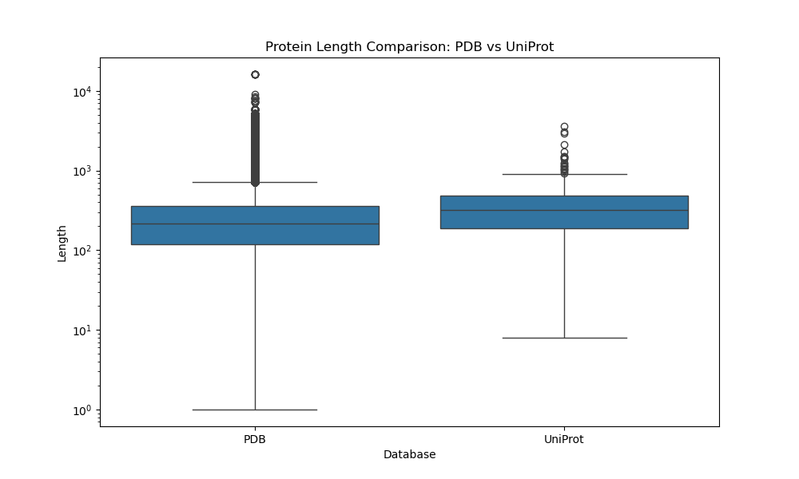
*Figure 6: Length distribution comparison between PDB structures and UniProt sequences (log scale).*

##### Amino Acid Composition Comparison
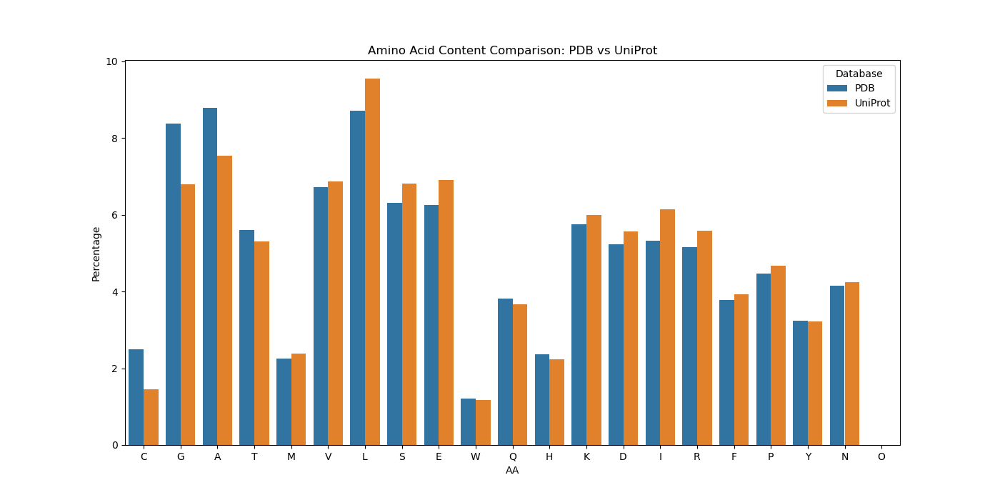
*Figure 7: Average amino acid content comparison between PDB and UniProt.*

##### Detailed Comparison Table

| Group   |   Mean_Length |    SE |   Median_Length |   Sample_Size |
|:--------|--------------:|------:|----------------:|--------------:|
| PDB     |        287.26 |  4.51 |             214 |       1104352 |
| UniProt |        391.35 | 18.63 |             319 |           400 |

##### AA Composition Stats (PDB vs UniProt)

| Group   | AminoAcid   |   Percentage |   StdErr |
|:--------|:------------|-------------:|---------:|
| PDB     | A           |         8.78 |    0.027 |
| PDB     | C           |         2.5  |    0.015 |
| PDB     | D           |         5.23 |    0.021 |
| PDB     | E           |         6.25 |    0.023 |
| PDB     | F           |         3.78 |    0.018 |
| PDB     | G           |         8.37 |    0.026 |
| PDB     | H           |         2.36 |    0.014 |
| PDB     | I           |         5.33 |    0.021 |
| PDB     | K           |         5.76 |    0.022 |
| PDB     | L           |         8.72 |    0.027 |
| PDB     | M           |         2.25 |    0.014 |
| PDB     | N           |         4.16 |    0.019 |
| PDB     | P           |         4.47 |    0.02  |
| PDB     | Q           |         3.82 |    0.018 |
| PDB     | R           |         5.15 |    0.021 |
| PDB     | S           |         6.32 |    0.023 |
| PDB     | T           |         5.6  |    0.022 |
| PDB     | V           |         6.71 |    0.024 |
| PDB     | W           |         1.22 |    0.01  |
| PDB     | Y           |         3.23 |    0.017 |
| UniProt | A           |         7.53 |    1.319 |
| UniProt | C           |         1.44 |    0.596 |
| UniProt | D           |         5.56 |    1.146 |
| UniProt | E           |         6.91 |    1.268 |
| UniProt | F           |         3.93 |    0.971 |
| UniProt | G           |         6.8  |    1.259 |
| UniProt | H           |         2.23 |    0.738 |
| UniProt | I           |         6.14 |    1.2   |
| UniProt | K           |         6    |    1.187 |
| UniProt | L           |         9.55 |    1.47  |
| UniProt | M           |         2.39 |    0.763 |
| UniProt | N           |         4.25 |    1.008 |
| UniProt | P           |         4.68 |    1.056 |
| UniProt | Q           |         3.66 |    0.939 |
| UniProt | R           |         5.59 |    1.148 |
| UniProt | S           |         6.81 |    1.26  |
| UniProt | T           |         5.3  |    1.12  |
| UniProt | V           |         6.87 |    1.265 |
| UniProt | W           |         1.17 |    0.538 |
| UniProt | Y           |         3.22 |    0.882 |

We can observe huge difference between PDB (287 AA) and UniProt (391 AA) databases. That is because PDB, contains only experimentally determinted structures which overrepresented shorter structures. For this process proteins needed to be crystalized for X-ray difffraction, which is problematic with longer proteins. UniProt contains also predicted proteins which are longer.
## Bibliography

1. Kühlbrandt, W. (2014). The Resolution Revolution. *Science*, 343(6178), 1443-1444.
2. Varshavsky, A. (2011). The N-end rule pathway and regulation by proteolysis. *Protein Science*, 20(8), 1298-1345.

